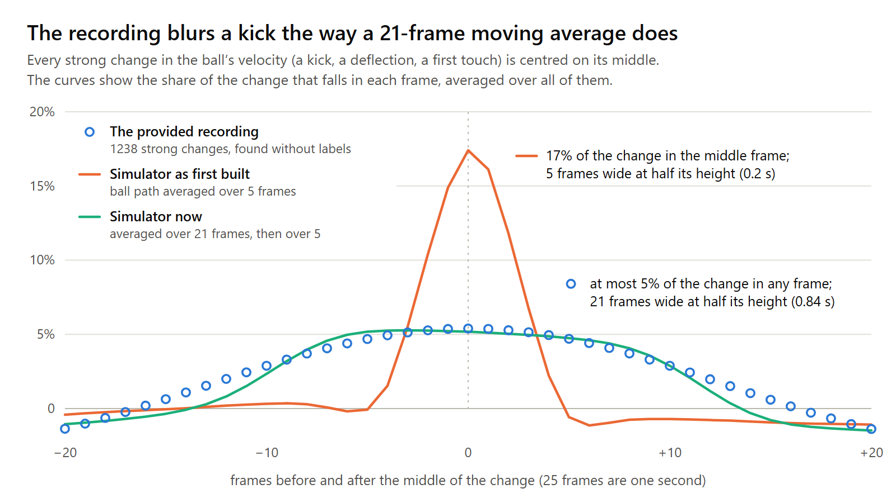
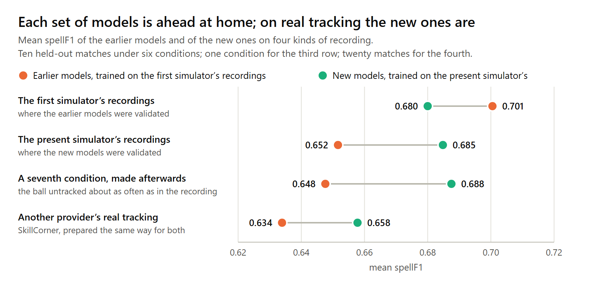

# Excensia Vantage: possession from automatic tracking, learned on other matches

Technical document, More than a Hack 2027, Phase 1. Team **Excensia**: Jason Heath, Diego Cortés
Núñez, Lluís Lansac Martí. Repository: https://github.com/Skillwager/excensia-vantage

**In brief.** SUBMISSION.md asks this document for six things. They are sections 1, 3, 4, 5, 7
and 8, and this page says each of them in a few lines. Sections 2 and 6 are the evidence.

- **Approach (section 1).** Nothing may be learned on the match, so everything is learned on ten
  open matches whose possession is known, after a simulator has made their clean tracking look
  like this recording's automatic tracking. Two gradient-boosted tree models read 433 numbers a
  frame, and a Viterbi decoder turns their answers into whole possessions.
- **What the recording turned out to be (section 2).** Read off whole-match totals without a
  label: the tracker averages every path over about 21 frames, slows a track to a stop as it ends,
  reports no gap between 0.6 and 5 seconds, and picks the ball up as it is struck. So a missing
  ball in this data does not by itself mean a stoppage, or live play. It means the tracker
  has lost the ball for more than five seconds. The simulator was rebuilt six times to do the same, each version was
  read by an independent reviewer, and what it still gets wrong is listed.
- **Assets (section 3).** Used: the tactical tracking, and Smart Tagging (set pieces as restarts,
  attacking phases as a bounded vote). Tried and left out: the broadcast recording, which adds
  a ball on only 3.7% of the graded frames. Not used: homography and video. The section also sets out in
  full how the provided match was handled.
- **Training data (section 4).** Seven matches of the open DFL dataset and Metrica's three
  sample games, with labels taken from their sources' own data. Nothing from the provided
  game, and nothing labelled by hand. SkillCorner's twenty open matches check the finished method.
- **Possession rules (section 5).** Three states. No minimum length in the labels, because the
  public five minutes hold possessions of 0.8 and 1.3 seconds; the decoder absorbs only what is
  shorter than 0.8 seconds. A loose ball stays with the last team. A gap in the
  ball's track is not filled in: the model decides what it was.
- **How good (section 6).** On the ten open matches, held out two at a time and recorded by the
  simulator under six conditions, spellF1 is 0.685 (0.65 in the harshest condition, 0.71 in
  the easiest) and macroF1 0.921. On SkillCorner's real automatic tracking, whose labels are of
  a different kind, spellF1 is 0.658. These models replaced earlier ones under a rule written
  before the test: 0.033 better, on all ten matches. That margin is partly a home advantage,
  so section 6 checks it further; on SkillCorner's recordings, with both sets of models
  reading the same prepared recordings, the new ones win 19 matches of 20.
- **Limitations (section 7).** The simulator is the weakest link, and the validation is only as
  good as it is. The method finds 36% of the possessions under three seconds, and those are
  four in ten of all possessions.
- **Reproduction (section 8).** Three commands; the run takes under a minute, with no GPU. The same file, byte for
  byte, on Windows and on Ubuntu from a fresh clone. Its SHA-256 begins `3db85a27`.

## 1. Approach

The task is a sequence labelling problem with one hard constraint: nothing may be learned or
tuned on the match being labelled. So the method is built the other way round. Everything is
learned on **ten other matches** whose possession is known, after those matches have been made
to look like this recording, and the result is applied to the competition match unchanged.

1. **Other matches, labelled the way the ground truth is.** Seven matches of the open DFL
   dataset and Metrica's three public sample games give frame-level possession and dead-ball
   labels (section 4). They are used as the sources give them, short possessions included,
   because the ground truth has no minimum length for a possession (section 5).
2. **A simulator of this recording's tracker.** Corrected tracking has a ball on every frame and
   every player all game; automatic tracking does not. Each training half is passed through a
   simulator that does to it what the recording's tracker does, as far as that can be read off
   the recording without a label (section 2). What cannot be read off it, such as how often a
   stoppage is followed right through, is drawn from wide ranges on every pass, so the models
   cannot rely on one answer. Every training half is passed through it six times, each with its
   own draw.
3. **Features that need no identities and no ball on every frame.** For each frame: the ball and
   who is near it when it is seen; when it is not, how long it has been gone, how long until it
   returns, and what the picture was at both ends of the gap; which team last controlled or
   touched it and which does next, a touch being a change in the ball's velocity next to a
   player; where each team is, how spread, how fast, moving forward or back; the same signals a
   second, three seconds and ten seconds either side; and how far the frame is from a tagged
   restart (section 3). That is 433 numbers a frame: the 255 the first models read, and 178 added once the
   tracker was understood (section 2): touches found the way a path averaged over 21 frames
   shows them, the corner of the path rebuilt at each touch and who stands at it, the ball
   being carried, the ball's motion read where the slowed end of a track does not reach, and
   the ball and the nearest players a few frames either side. All are properties of sets of players, so track
   slots and their order never matter.
4. **Two tree models.** A frame classifier gives the probability of home, away and dead ball. In
   its training a frame inside a short possession counts for more: four times for a possession
   of two seconds or less, falling to once at eight seconds. The ranking metric counts a short
   possession as one possession like any other, and it has far fewer frames to be learned from.
   A boundary model answers a different question from the same features: is a turnover, a
   stoppage or a restart happening right here? Both are gradient-boosted trees (LightGBM). Each
   half is scored twice, as it is and with the teams exchanged and the pitch rotated, and the
   two answers are averaged, so the model cannot favour the side called "home".
5. **Decoding into possessions.** The ranking metric counts possessions as intervals, so the
   labels come from a Viterbi path over home, away and dead ball, not from the best label per
   frame. Changing state costs something everywhere, less where the boundary model sees a
   change and more where it does not; runs shorter than a minimum are absorbed. The phase tags
   of Smart Tagging enter here as bounded votes (section 3).

Why this rather than something else. Rules written by hand on nearest-player distance are the
published baseline, and its failure is the one the metric punishes: flicker, and no notion of a
stoppage. A neural sequence model on raw positions would need far more than ten matches. Trees
on engineered features learn from ten matches, take missing values as they are, and give the
same output on any machine, which the reproduction rule needs.

## 2. What the recording's tracker does, read off without a label

The method learns on other matches made to look like this recording. That only works if "like
this recording" is known, and the ground truth cannot be asked. So the tracker was read off the
recording itself: seven things, each a total over the whole match that uses no label. The
scripts named in brackets print them for anyone with the data. Below, "in the middle case" is
the median, three figures in a row are quartiles, and a "long gap" is five seconds or more with
no ball.

**1. It averages every path over about 21 frames.** A kick changes the ball's velocity at once.
In the recording it never does. Take every strong change of the ball's velocity (8 m/s or more
between the velocity twelve frames before and twelve frames after; 1,238 of them have an
unbroken path around them), line each one up on its middle, and average them. No frame holds
more than 5.4% of a change, and the curve is 21 frames wide at half its height (Figure 1;
`scripts/figure_kick.py`). That is what a centred moving average of 21 frames, 0.84 seconds,
does to a kick. In the open matches as published the same curve is 3 frames wide. The players'
paths are averaged the same way (24 frames wide; `scripts/edge_report.py`).



*Figure 1. What a kick looks like to the tracker. Circles: the provided recording, an average
over the whole match that uses no label. Lines: simulated recordings of the ten open matches,
with the simulator as it was first built and as it is now.*

**2. It ends a track by slowing it to a stop.** Over the last frames of a track of the ball
its speed falls to 0.73, 0.48 and 0.28 of what it was, ten, five and one frame from the end,
and 88% of the tracks end at under half their speed (the players' tracks: 96%). A track begins
at full speed. This is what a tracker produces if it goes on reporting a ball it has lost for
five frames at the place it last saw it, and its average takes that place for everything
after: the speed k frames before the end is then (k + 5)/21 of what it was
(`scripts/edge_report.py`).

**3. It reports no gap between 0.6 and 5 seconds.** The ball's track has 143 gaps. Fourteen last
under 0.6 seconds, 129 last 5.16 seconds or more, and none lies between
(`scripts/track_report.py`, as for findings 4 to 7). No tracker loses a ball for half a second
and for six seconds and never for two. We take it that this one fills in a loss of under about
five seconds and reports a gap only when a loss lasts longer. The fourteen short gaps fall
where the ball is fast: it comes back 7 metres from where it was a moment earlier.

**4. It picks the ball up as it is struck.** A track begins 0.66 metres from the nearest player
in the middle case, within 1.5 metres at two beginnings in three, with the ball already moving
at 12 m/s.

**5. After a throw-in or a corner it picks the ball up as the restart is taken, and the tag
comes early.** The two kick-off tags of Smart Tagging begin 3.52 and 3.28 seconds before the
kick-off frames the organisers publish, so a set-piece tag was read as putting a restart 3.5
seconds into its clip. At 37 tagged set pieces the ball is not in view around that moment and a
track begins within ten seconds of it: 68 frames after it in the middle case (24 and 92 at the
quartiles). We first read this as a tracker that finds the ball late, and built a simulator
that way. It is the tag that is early. At 14 such throw-ins the track begins at the touchline
(beyond it or less than two metres inside it at nine of them) with the ball moving in at 12.5
m/s, 67 frames after the moment read off the tag: that is the throw. At the 12 corners it
begins 81 frames after that moment with the ball at 21 m/s, by the goal line at eight of them
and within three metres of the corner flag at four: mostly the cross arriving, a second or
less after the kick. So at a throw-in or a corner play restarts two to three seconds after the
moment read off the tag. At goal kicks, free kicks and kick-offs after a goal the pick-up
comes one second after it in the middle case.

**6. It finds the ball not far from where it lost it.** When a gap of five to ten seconds ends,
the ball is 3.9, 7.7 and 20.9 metres from where the track broke off; after ten to thirty
seconds 4.3, 10.6 and 18.9; after a longer gap 9.9, 18.8 and 27.5. That is about twice as far
as play restarts from where it stopped in the labels of the open matches (4.2, 6.4 and 8.8
metres in the middle case), and half as far as in a simulator that lost the ball mostly in
running play (below). Most long gaps are waits, not a ball lost on its way across the pitch.

**7. It loses the ball in the field more often than at a line, and as the ball reaches a
player.** Of the 53 gaps of five to ten seconds, 53% begin in open field (more than three
metres from every line and outside both penalty areas), 19% in a penalty area and 29% at a
touchline or a goal line. In the open matches' labels a stoppage of that length begins at the
touchline three times in four. Four fifths of a second before such a track breaks off the ball
is still moving, at 6.4 m/s in the middle case, and lies still beside a player at one in four
(`scripts/loss_report.py`). What fits is a ball that is lost as somebody gathers it, a player
who will take a free kick or a goalkeeper, and is seen again when it is next struck. The
recording cannot say more than that without labels.

**What a gap means, then.** In this recording a missing ball is not a stoppage, and it is not
live play either. It is a ball the tracker has lost for more than five seconds: one that left
the pitch, or one that somebody gathered and nobody struck for a while. How many of the gaps
are stoppages cannot be read off without labels, but the players give an indication. They slow
to under three quarters of their earlier pace in 43% of the recording's 53 gaps of five to ten
seconds, in 63% of its gaps of ten to thirty seconds and in 84% of the longer ones. In
simulated recordings of the open matches, where the labels give the answer, gaps in which the
players slow that often are stoppages about half the time in the shortest band, three times in
four in the middle one and nine times in ten in the longest. With 53 gaps the first figure is
uncertain by a quarter either way. A tracked ball, the other way round, is no proof of live
play: the tracker fills in short losses, and at a third of the tagged set pieces it has the
ball in view through the two seconds either side of the moment read off the tag, which is
before the restart.

What the finished file makes of the gaps (`scripts/restart_check.py`): of the frames inside
gaps of five to ten seconds it calls 69% dead ball where the ball was lost at a line and 43%
where it was lost in the field. For gaps of ten to thirty seconds that is 91% and 84%, and for
longer ones 97% and 98%. Half of the 38 gaps of five to ten seconds that begin away from a
line it calls live from end to end.

The table sets the simulator beside the recording. Its first part is what the simulator's
settings were chosen to reproduce. Nothing in the present settings was chosen to fit the
second part; it shows where the simulator still differs. Two figures in a cell are the seven
DFL matches and Metrica's three sample games, in the simulator's typical setting; one figure
is all ten.

| A total over a whole recording, no label used | The recording | Simulator as first built | Simulator now |
|---|---|---|---|
| **What the settings were chosen to reproduce** | | | |
| A strong change of the ball's velocity: frames wide at half its height | 20.8 | 5.0 | 20.0 |
| The same for a player | 24.0 | 6.6 / 4.8 | 23.2 / 22.6 |
| The ball's speed 1, 5 and 10 frames before its track ends, over its speed before that | 0.28, 0.48, 0.73 | 0.74, 0.81, 0.88 / 0.98, 1.00, 1.00 | 0.26, 0.44, 0.67 / 0.29, 0.48, 0.72 |
| Gaps of 0.6 to 5 seconds, a minute | 0.00 | 0.10 / 0.22 | 0.00 / 0.00 |
| A gap under 0.6 seconds ends this far from where it began (middle case) | 7.2 m | 0.8 m / 0.8 m | 6.8 m / 6.7 m |
| Frames with a tracked ball | 59% | 60% / 64% | 60% / 60% |
| A track begins within 1.5 m of a player | 67% | 20% / 42% | 62% / 72% |
| A track ends within 1.5 m of a player | 53% | 29% / 33% | 45% / 40% |
| Tagged set pieces with a tracked ball on every frame of the two seconds either side of the moment read off the tag | 32% | 35% / 28% | 33% / 36% |
| At the others: frames from that moment to the pick-up, quartiles | 24, 68, 92 | -15, 2, 14 / -6, 17, 39 | 39, 78, 98 / 6, 61, 83 |
| **Read while building; nothing in the present settings fitted to it** | | | |
| Gaps of 5 seconds or more, a minute | 1.24 | 0.83 / 0.75 | 0.99 / 0.98 |
| Of which gaps of 5 to 10 seconds | 0.51 | 0.15 / 0.18 | 0.29 / 0.30 |
| Length of a track, middle case | 13.7 s | 23.4 s / 23.1 s | 19.2 s / 22.7 s |
| After a long gap the ball is found this far from where it was lost (middle case) | 11.1 m | 9.4 m / 10.5 m | 15.4 m / 17.5 m |
| Gaps of 5 to 10 seconds that begin at a touchline or a goal line | 29% | 60% / 49% | 30% / 37% |
| Gaps of 5 to 10, 10 to 30 and over 30 seconds in which the players slow to under three quarters of their pace | 43%, 63%, 84% | 56%, 72%, 79% / 53%, 71%, 72% | 36%, 58%, 77% / 40%, 48%, 67% |
| Strong changes of the ball's velocity with nobody within 3 m, a minute of tracked ball | 4.1 | 7.1 / 5.4 | 4.5 / 2.3 |
| Touches the features find, a minute of tracked ball | 19.5 | 33.1 | 19.0 |
| At a hard touch, a player within a metre of the rebuilt corner, and of the reported ball (see below) | 55%, 23% | 25%, 32% | 47%, 12% |
| Frames with five or more of the 22 players missing | 8.6% | 6.5% / 4.5% | 5.2% / 4.3% |
| **A classifier asked to tell the recording from simulated recordings (AUC; 0.5 is "cannot"), settings drawn as in training** | | | |
| From the ball's features | | 0.80 | 0.62 |
| From the features of gaps | | 0.71 | 0.62 |
| From the touch features | | 0.65 | 0.56 |
| From the features of the two teams' shape | | 0.92 | 0.92 |
| From all of them | | 0.95 | 0.91 |

The last five lines need a yardstick. With an open match put in the recording's place the same
classifier scores 0.51 to 0.56 on the ball, 0.55 to 0.59 on gaps, 0.52 to 0.57 on touches, 0.6
to 0.69 on team shape and 0.54 to 0.63 on everything (`scripts/adversarial.py`: it learns on
one half of each recording and is asked about the other). The classifier is a diagnostic: its
scores said where to look for flaws in the simulator, and no model of the method is fitted
with it. By it, the simulator's ball is much nearer the recording's than it was, and not yet
as near as one open match is to another.

Team shape tells the recording apart as before. That is partly the football, which no
simulator of a tracker changes: each team's deepest player stands 9.4 metres from his goal
line in the middle case in the recording, 14.4 in the seven DFL matches as published and 9.6
in Metrica's three. It is partly the tracker: five or more players are missing on 8.6% of the
recording's frames, nine in ten of those inside gaps of the ball's track of fifteen seconds or
more, and on 4 to 5% of the simulator's (`scripts/shape_report.py`).

The second part of the table shows where else the simulator differs. The recording has more
gaps and shorter tracks, its ball comes back nearer to where it was lost (on that total the
first simulator was nearer than the present one), and the players slow in more of its gaps. It
has 0.51 gaps of five to ten seconds a minute; the six test conditions of section 6 have 0.22
to 0.38. In how often the players slow, and in how far away the ball comes back, the recording
lies between the typical and the easiest condition. Read together: the typical setting loses
the ball in running play somewhat more often, and at stoppages somewhat less often, than this
tracker did in this match.

**The simulator now.** Ball and players are averaged over 21 frames (19 to 23 for the ball, by
draw, after a short average of five), track by track, and a ball or a player that is lost is
held five frames and slowed to a stop; nothing is averaged across a gap. For each stoppage in
the labels a draw decides whether the tracker follows it. If not, the ball is lost as it leaves
the pitch or, when it stays on the pitch, a little later as somebody reaches it, and it is
picked up as the restart is struck, sometimes earlier. In live play the ball is lost at a
drawn rate, as it reaches a player, and picked up at a kick. A ball that comes to rest within a
player's reach is lost by one rule that does not ask whether play is live. A loss of under 5.36
seconds is not reported; with the five held frames that makes the shortest gap 5.16 seconds,
as in the recording. When a stoppage is followed, the ball's path through it is drawn: it rolls
on from its own motion, slowing at a steady rate drawn for each stoppage, is carried or passed
to the place of the restart, and waits there. The imitated set-piece tags run early as the
real ones do. Picking the ball up at a kick and losing it at a player have the same chance in
play and out of it. How often each thing happens is set so that the first part of the table
comes out, and for every training pass it is drawn from a range around that setting.

**What we got wrong on the way, and what caught it.** The simulator was rebuilt six times.
Each new version was read by an independent reviewer, a second AI session that was given the
code and not the results; one version was read twice, and six of the seven readings found
something.

- The second version averaged the ball's true path over 21 frames before hiding frames, so the
  first and last frames of a track held a trace of where the hidden ball had been. From the
  fourth version on a path is averaged inside each track, after frames are hidden, and a test
  fails if that changes.
- The fourth read the tags as the moment of the restart and so made its tracker find the ball
  three seconds late. Its models scored better on its own recordings, on the four held-out
  matches that had been read, and it was on its way to being adopted. What stopped it was one
  more total: in its recordings the ball came back 21 to 27 metres from where it was lost, in
  the real one 11. Looking for the reason gave findings 5 to 7.
- The fifth, as first cut, lost a resting ball by different rules in live play and in a
  stoppage. That would have let the models read "stoppage" off the simulator and not off the
  football. The rule is now blind to the label.
- The next reading found a mark that was in the open data itself, and so in every version from
  the first: in the DFL matches as published the ball stops dead on the first frame of a
  stoppage. Its velocity changes by 3 m/s or more across that frame at 85% of the stoppages
  that begin with the ball moving, against 21% of moments in live play, and 33% at the
  stoppages of a real automatic tracker, SkillCorner's (`scripts/stop_profile.py`). The ball's
  path through a stoppage is now drawn for both sources, and the figure is 24 to 27%, as in
  the simulator's live play.
- The sixth drew that path with one law, a speed that falls by the same fraction every second,
  so twelve frames after any moment the ball always had 0.62 of its speed. The seventh draws a
  rate for each stoppage.
- The reader of the seventh found no error. What it found short of that is in section 7.

A method that is validated on a simulator inherits the simulator's mistakes without a sign. So
every setting that can be tied to a total anyone can print is tied to one, the totals nothing
was fitted to are printed beside them, and six batches of cross-validation run on the versions
above were stopped or set aside. The decision in section 6 rests on the one batch run for it
on the last version, under a rule written down before it started. A second batch on that
version tried three variants on top of the chosen models, and none was adopted.

**One reference smoothness.** Smoothing can be added and cannot be taken away, so the models
are trained at the recording's smoothness and a sharper recording is brought to it first: a
label-free measure (at a strong change of velocity, the share of it already there over eight
frames) decides whether a moving average is needed and how long (`vantage/smoothing.py`). The
provided recording measures 0.42 on both halves and is left as it is. The 40 halves of
SkillCorner's twenty matches (section 6) measure 0.66 to 0.70, and their ball paths are given a
moving average of 21 to 23 frames before the models read them (the players' paths are left as
recorded).
The
same step fills in what this tracker never reports: in another tracker's recording a gap of 16
to 128 frames in the ball's track is bridged with a straight line from where the ball was lost
to where it is found. The provided recording has no such gap and comes through unchanged. The filter itself cannot be undone, because it is close to a moving average
of 21 frames and not exactly one: the averaged kick of Figure 1 is rounder than such an average
makes it.

**A consequence, tested afterwards.** If the reported path is an average of a sharp one, it is
still true outside the reach of the average: a straight line coming into a touch and a
straight line going out. Extended to the frame of the touch they must meet, and at somebody's
feet. In the recording they do (`scripts/corner_check.py`). At its 912 hard touches (a change
of 10 m/s or more) the two lines end a quarter of a metre apart, and the point half way
between them has a player within a metre 55% of the time, against 23% for the reported ball,
which the average has pulled 1.7 metres from the nearest player. The simulated recordings give
47% against 12%, and there the published ball says how good the rebuilt corner is: 0.85 metres
from the truth in the middle case, against 1.75 for the reported ball. The rebuilt
corner, and who stands at it, are among the model's 178 added inputs.

## 3. Assets: what is used, what is not

| Asset | Use |
|---|---|
| Tactical tracking (`_atd.xml`, `_atd.txt`) | The input. Positions and team membership of the track slots, and the ball. The file's per-slot speed is not used; speeds are recomputed from positions the same way for every match. |
| Smart Tagging: set pieces | The 59 set-piece tags are used as restarts: four of the model's inputs say how long until and since a tagged restart and, where the tag names a team, whose it is. Each tag is a clip, and the two start-of-half kick-off tags begin 3.52 and 3.28 seconds before the kick-off frames the organisers publish, so the inputs count from 3.5 seconds into each clip. At a throw-in or a corner the restart itself comes two to three seconds after that: the ball's track returns six to seven seconds into those clips, at the touchline as the throw is taken or by the goal line as the cross arrives (section 2, finding 5; `scripts/set_piece_profile.py`). No other match has these tags, so for training they are imitated on the external matches from their own labels, with the same habit: a share of the real restarts is tagged, the kick-off on time, 10 to 40% of the others on time and the rest early, by 2.4 to 3.6 seconds on average, some with the team, and a few tags point at nothing. How many, how early and how often with a team are drawn afresh for every half (`vantage/external.py`). The models were therefore validated using tags the same way they use them on the match. A tag never sets a label. |
| Smart Tagging: phases | A light vote for the team, added before decoding, from the four attacking phases only (build up, progression, creating chances, attacking transition). One tag is worth a fixed total of 3 in log-odds however long it is; that weight is a reasoned constant, because no other match has these tags to tune it on. A label-free check (`scripts/tag_check.py`) decided what votes. The phases are tagged where the ball is tracked (it is missing on 7% of their frames against 41% overall), so they add little where help is needed; on live frames they agree with tracking-only labels 92 to 98% of the time for build up and progression. The defending-phase tags repeat the attacking ones interval for interval and are not counted twice. Ball in final third, ball in the box, players in the box and long ball run through stoppages and through the other team's possession and are not used. |
| Published constants | The graded frame ranges, the second-half kick-off frame and the fact that the graded frames before it are dead ball (DATA.md, FAQ.md). Ungraded frames are written `X`. |
| Public 5-minute ground truth | Used to read the definition and to check the pipeline, as CHALLENGE.md and EVALUATION.md ask. No number was fitted to it, and no version was chosen by its score. The full account is below the table. |
| Homography, tactical video | Not used by the method. The viewer in this repository shows the method's output drawn from the tracking and opens no video beside it. For the organisers' public five minutes it plays the tactical video with their labels, and uses the homography to draw the provided tracking on the picture (see "How the provided match was handled"). |
| Broadcast video, tracking and homography | Not used in the file. The broadcast tracking was placed on the tactical frames, without labels or video, to count what its ball would add where the tactical tracker has none. It adds little (a ball on 3.7% of the graded frames), and what it adds cannot be validated on other matches (section 6, "The second recording"). The broadcast video and homography are not used by anything here. |

**What the public five minutes were used for, in full.** Three things were learned from them,
and each changed the method.

1. *The definition has no minimum length.* They contain possessions of 0.8 and 1.3 seconds in
   the middle of live play. A first version had read "keeps the ball for a few seconds" as a
   rule and merged shorter spells in its training labels. That reading was wrong and was dropped
   (section 5).
2. *A pipeline check failed on dead ball.* Run on a finished file, the check found frames aligned
   and home and away the right way round, but only a quarter of the dead-ball frames marked dead.
   Totals over the window showed why: two of its four stoppages have a ball on every frame, and
   the simulator had assumed a stoppage almost always hides the ball. The assumption was removed:
   the chance that a stoppage keeps its ball is now drawn from 0 to 0.7. The same fact shows
   without the ground truth. The five seconds before a tagged restart are stoppage time by the
   tag alone, and over the 57 tagged restarts that have those five seconds on record the ball
   is tracked on a third of the frames, and on every one of them at 12 restarts
   (`scripts/set_piece_profile.py`).
3. *What a ball does in such a stoppage* was then taken from the whole recording without labels
   (`scripts/slow_report.py`): while the players are close to standing still, the tracked ball is
   at rest on only a fifth of the frames. The simulator was changed to move it, and compared with
   the recording on those label-free totals, not on the window.

The check itself is pass or fail, on criteria written down before the final file was checked:
teams agree where both files say the ball is alive, dead ball is found in stoppages with and
without a tracked ball, and the number of possessions is of the right order. Its spellF1 was
read on five earlier files, and all five readings are in section 6, including two that came out
lower after a step that had been adopted on other matches. For the final file the check printed
pass or fail and nothing else: its spellF1 on the window was not read. Seventeen possessions cannot rank two versions, and no version
was chosen that way; versions were compared on other matches only.

The organisers' clarification of 3 November 2026 allows automatic checks on the provided data
and inspecting it to understand what counts as possession, and does not allow training, fitting
or calibrating on the ground truth. We read the three uses above as the first kind: each changed
what the method takes a label to mean, none set a number from the ground truth, and every number
that followed came from other matches, from wide ranges or from label-free totals. They are set
out in full so that the organisers can judge that for themselves.

**How the provided match was handled.** It is read at inference, and it was read for label-free
totals: `scripts/match_check.py` compares the loader against the figures in DATA.md (it
reproduces them exactly: the ball on 94,214 of 158,857 graded frames, 20.5 tracked players on
average), and `scripts/domain_report.py` prints percentiles and shares for a whole half, never a
frame. Those totals shaped the simulator's ranges, and the totals of section 2 shaped the
simulator itself. The second recording's tracking was read the
same way, for the counts in section 6 (`scripts/broadcast_align.py`, `scripts/broadcast_try.py`),
and nothing in the file comes from it. No frame of the match was labelled, corrected
or inspected by a person for this method, and no constant refers to a frame or a moment of the
match. The method never compares its output with the video.

One thing has to be reported here. On 10 November the assistant added to the viewer a page that
plays the tactical video beside the finished labels, ran a script on it that compares the video
player's clock with the viewer's clock (durations and clock readings, nothing of the output set
against the picture), and opened the page on a team member's computer. That was a mistake: the
organisers' clarification of 3 November does not allow output to be checked against the video,
and the assistant had not read it into its work. The page was closed and the option removed
within hours. The run file of this match now tells the viewer to open no video beside it.
Nobody looked at the page: the assistant does not look at the match, and the team member on
whose computer it was opened has confirmed that he never saw it. No label, correction, constant
or choice between versions came from it; those choices are made on other matches (section 6).
What the team does look at is the finished file in the viewer, with the match drawn from its
tracking, and nothing is changed because of that either.

The team has also watched the tactical video, on its own and with the organisers' public five
minutes of labels over it (`scripts/public_truth_run.py` writes those labels as a file for the
viewer), to see what the labels mean, which the clarification allows. On that page the viewer
draws the provided tracking on the picture through the provided homography: a ring round the
tracked ball, the two teams' outlines, the players' runs. An automatic check
(`viewer/scripts/footage-align.mjs`) confirmed in numbers, with nobody looking, that tracking,
homography and video are in step to the frame. The model's output was not on the screen with the
video, and nothing in the method was changed because of what was watched.

**AI assistance.** The code and this document were written with a hosted AI coding assistant
(Claude). The tracking rows, tags, homography and video of the match were kept out of its
context: it worked through scripts that run on the local machine and print totals (counts,
shares, percentiles) over a half, a five-minute block, the public window, a stoppage of that
window, all the tags of one kind or all the gaps in the ball's track of one band of length,
never frames. The scripts are in `scripts/` and print the
same totals for anyone who runs them. The finest things it saw are the share of each of the four
public stoppages that has a tracked ball, how far the two kick-off tags start before the
published kick-off frames (3.52 and 3.28 seconds), and one reading of 13 November: for each of
the two kick-offs, whether the ball is tracked over the 60 frames before the published kick-off
frame, how fast it is moving then, the top speed it reaches afterwards and how many frames that
takes. That reading was meant to time the tracker's ball against a known moment and showed
nothing usable (at one kick-off the ball has no track, at the other it is already moving), and
nothing in the method comes from it. It also saw the 41 whole-match averages that Figure 1
draws, and, on the same day, the totals section 2 rests on, which are finer than anything
before them: how many gaps the ball's track has in each band of length (some bands hold one or
two gaps) and the length of the shortest long one; quartiles of where and when the ball is
picked up over the 14 throw-ins, over the 12 corners and over the 11 other set pieces the
tracker does not follow; and, for the gaps of one band of length (19 to 57 gaps, or as few as
six once they are split by where the ball was lost), in which part of the pitch the ball is
lost and found, how far it has moved, how fast the players move, and what the finished file
calls them. Later the same day it saw more of the same kind: how far away the ball comes back
after the 14 gaps under 0.6 seconds; percentiles of the ball's speed 20 frames before 117 of
the 129 long gaps begin, and how often it then lies still beside a player; whole-match shares
(a tracked ball more than a metre outside the pitch, five or more players missing, a still
ball within a player's reach, a free ball's speed twelve frames on); percentiles of how far
each team's deepest player stands from his goal line; the per-second averages over all the
tags of one kind that `scripts/set_piece_profile.py` prints; and what the classifier in
section 2's table prints, which is fitted on the local machine to rows of features of the
recording and of simulated recordings: its scores and, for the inputs that tell the two
apart best, percentiles of their values over the whole recording. Each is a count, a share
or a percentile over a group; none names a frame, a place or a moment. Of the second recording it saw the two shifts that put its tracking on the
tactical frames, one for each half, and totals over the graded frames. Of the video it saw the
length and the frame size, from the clock comparison reported above. Two exceptions. Before the team had read that
rule, a file search on a cloud drive returned to the assistant the opening lines, about a
thousand characters each, of the two tracking metadata files, and the bundle's README. They
describe the file layout, and the method takes nothing from them that DATA.md does not publish.
And on 10 November a team member, asking for a change to the viewer's display, pasted into the
assistant's chat one screenshot of the viewer on the public five minutes: one frame of the
tactical video, the tracked positions at that moment and the timeline of the organisers' public
labels. That is provided data reaching an AI service, which the rules do not allow. It was one
frame, it was not asked for, and nothing in the method came from it.

## 4. Training data

All of it is from other matches. None of it is from the provided game.

| Dataset | Matches | Labels | Who produced the labels |
|---|---|---|---|
| Bassek, Rein, Weber, Memmert (2025), *An integrated dataset of spatiotemporal and event data in elite soccer*, doi:10.6084/m9.figshare.28196177.v1, CC BY 4.0 | 7 (2 Bundesliga, 5 2. Bundesliga, 2022/23) | Per-frame `BallStatus` (in play / dead) and `BallPossession` (home / guest) in the official position data | The league's official data provider, as published. About 1.0 million frames. |
| Metrica Sports sample data, https://github.com/metrica-sports/sample-data, published by Metrica for the football analytics community; its terms ask that the source be acknowledged | 3 anonymised matches | Derived by code from the published files: a stretch with no ball position of half a second or more is a dead ball (in this corrected tracking the ball has no position while play is stopped); while play is live the ball belongs to the team of the latest on-ball event (set piece, pass, carry, shot, recovery, ball lost, ball out) | Metrica's tracking and events as published; the derivation is `vantage/metrica_sample.py`. About 0.43 million frames. |

We added no labels of our own to any match. `scripts/fetch_external.py` downloads the first
dataset and checks every file against its published checksum; the second is a `git clone`.

A third open source is used to check the finished method and not to train it: SkillCorner's
open data, twenty matches of the 2024/25 Australian A-League with tracking made automatically
from the broadcast picture (https://github.com/SkillCorner/opendata, MIT licence, with thanks to
SkillCorner; `scripts/fetch_skillcorner.py` downloads it and checks every tracking file against
the repository's own checksum). Section 6 says what it showed and why it is not training data.

One more source was looked at and set aside. PFF FC has released tracking and events for the 64
matches of the 2022 World Cup, which would have been six times the labelled matches used here.
No licence is published with it and access is through a sign-up form, so it could not be shown
to be data the organisers can access and inspect, and it was not downloaded.

## 5. The possession rules implemented

Most rules here are learned from the labelled matches, so the rules are in how those labels are
defined and in how the decoder is constrained.

- **Three states.** Home, away, dead ball. Abstentions (`X`) are written only on ungraded frames.
- **No minimum length in the labels.** The challenge text asks for controlled possession and offers "a player
  keeps the ball for a few seconds" as a proxy. It also says the ground truth is taken
  mechanically from corrected tracking with nothing smoothed, and that where a reading of the
  text disagrees with the public five minutes, the ground truth is right. Those five minutes
  contain possessions of 0.8 and 1.3 seconds between two spells of the other team. So a short
  possession is a possession, and the labels of the external matches are used as given:
  in Metrica's sample games the ball belongs to the team of the latest on-ball event (28% of
  those possessions are under two seconds), and the DFL flag is the provider's own. The decoder
  does have a minimum: it absorbs a possession shorter than 0.8 seconds, a value chosen by
  cross-validation against such labels (section 6), and a stoppage shorter than half a second,
  which is fixed.
- **Touches that do not count.** A challenge, a deflection and a duel won without control are
  not on-ball events in Metrica's data, so they do not change possession in the labels the model
  learns from. That is the challenge's own list.
- **Loose and contested balls** stay with the last team on the ball. That is how the labels are
  built, and the features give the model the last and the next team to control or touch it.
- **A ball that is not tracked.** The gaps of this recording are not filled in. A gap in its
  ball's track says neither "stoppage" nor "live play" by itself: it is a ball the tracker has lost for more
  than five seconds, because it left the pitch or because somebody gathered it and nobody
  struck it for a while (section 2). A gap is described by its length and by what the ball and
  the players were doing at both ends and throughout, and the model decides whether it is a
  stoppage, live play, or one then the other. It has learned that from gaps of these lengths.
- **A goalkeeper or a player holding the ball** is in possession. The tracker can lose the
  ball there, so the model has to carry the team through the gap; the training recordings lose
  a resting ball by the same rule whether play is live or not, so a gap of this kind is not
  taken for a stoppage because of how it begins.
- **Dead ball** is whatever the labelled matches mark as dead: from the ball leaving play or the
  whistle to the restart. Stoppages shorter than the decoder's minimum are not created.
- **Dead ball with the ball in view.** A stoppage is not the same thing as a missing ball. At a
  third of the tagged set pieces the tracker has the ball in view in the seconds before the
  restart, and then the evidence is elsewhere: the players slow to a walk, the ball is near a
  line or is carried to a spot and waits there. The model is trained on stoppages of both
  kinds.
- **Restarts** are placed where the evidence says play resumed. The tracker picks the ball up
  as it is struck, so after a stoppage it could not follow, the beginning of the next track is
  the restart, or close to it. A set-piece tag says a restart is coming and whose it is; at a
  throw-in or a corner the restart follows the moment read off the tag by two to three seconds
  (section 2), and the model has learned that lag from tags imitated the same way.
- **Minimum lengths and switching costs** are chosen by cross-validation on the external matches
  (section 6) and stored in `models/vantage.json`.

## 6. Validation, on other matches only

Five folds over the ten matches, two held out at a time. Every held-out match is scored whole,
with the organisers' own metric code (the batches use a faster search for the overlaps, checked
against theirs in every run), against the labels of section 4, as the
simulator of section 2 records it under six conditions: easy, typical, watched (more stoppages
followed right through), harsh, and two drawn at random from the ranges used in training. One
decoding setting serves every fold and condition. It is chosen on Metrica's three sample games,
because their labels come from the provider that made the ground truth; the seven DFL matches
are reported beside them.

spellF1, mean over the held-out matches (`python scripts/cv.py summary --tag S7all_g7 --sources metrica`):

| Held-out matches | easy | typical | watched | random 1 | random 2 | harsh | mean of the six |
|---|---|---|---|---|---|---|---|
| Metrica sample games (3) | 0.729 | 0.724 | 0.698 | 0.709 | 0.704 | 0.668 | **0.705** |
| DFL matches (7) | 0.706 | 0.690 | 0.675 | 0.666 | 0.673 | 0.647 | **0.676** |
| All (10) | 0.712 | 0.700 | 0.682 | 0.679 | 0.682 | 0.653 | **0.685** |

macroF1 over the same cells is 0.921 (0.915 on Metrica's games, 0.923 on the DFL matches). The
sixty cells, one match under one condition, run from 0.609 to 0.751, and the ten matches from
0.634 to 0.722 on the mean of their six conditions. The decoding setting is not delicate: the
eight best of the 192 tried are within 0.001 of each other on Metrica's games. The one chosen
makes a change of team cost 2 and a change to or from dead ball 10, weighs the boundary model
at 12, and absorbs a possession shorter than 0.8 seconds (`models/vantage.json`). A stoppage
shorter than half a second is absorbed under every setting. The method writes fewer possessions than there are, 0.78 for every
true one in the typical condition.

What these numbers say about the match itself is limited, and we would rather say so here than
leave it to be found. They are scores on recordings the simulator made. If the simulator is
right in what matters, the match is one more cell: somewhere from 0.61 to 0.75, and more often
than not between the harsh and the easy mean, 0.65 to 0.71 (35 of the 60 cells are). A seventh condition, made afterwards to
be near the recording's shares of untracked dead ball and untracked live play, gives 0.688
(below). Section 2 lists where the simulator is known to differ from the recording, and what
those differences cost is not known. The nearest thing
to a number from outside the simulator is further down, on SkillCorner's matches.

**The decision, and the rule it was made by.** Until 13 November the file we meant to submit
came from the same two models trained on the simulator as first built, reading 255 inputs. On
its own validation it scored 0.701 over the ten matches. Asked about the same held-out matches
as the simulator of section 2 records them, those models score 0.652: the test has become
harder and, by most of the totals in section 2, more like the recording. The rule was written down
at 12:06 on 13 November for a batch on an earlier version, and restated unchanged at 16:35 for
this one, which started at 17:19: models trained on the new recordings replace the old ones if they
score at least 0.005 more over the ten matches with at least eight of the ten gaining, and the
added inputs are kept only if they clear the same bar again. Each run is scored at its own best
decoding setting, chosen on Metrica's games (`scripts/compare_cv.py`).

| Held-out match | The earlier models | Retrained, 255 inputs | Retrained, 433 inputs | 433 inputs over the earlier models | 433 inputs over 255 |
|---|---|---|---|---|---|
| DFL J03WMX | 0.595 | 0.609 | 0.634 | +0.040 | +0.026 |
| DFL J03WN1 | 0.608 | 0.632 | 0.653 | +0.045 | +0.021 |
| DFL J03WOH | 0.661 | 0.678 | 0.703 | +0.042 | +0.025 |
| DFL J03WOY | 0.645 | 0.654 | 0.677 | +0.032 | +0.023 |
| DFL J03WPY | 0.654 | 0.669 | 0.672 | +0.018 | +0.003 |
| DFL J03WQQ | 0.642 | 0.665 | 0.688 | +0.046 | +0.024 |
| DFL J03WR9 | 0.669 | 0.684 | 0.704 | +0.035 | +0.020 |
| Metrica game 1 | 0.690 | 0.708 | 0.722 | +0.032 | +0.014 |
| Metrica game 2 | 0.664 | 0.675 | 0.690 | +0.026 | +0.015 |
| Metrica game 3 | 0.688 | 0.694 | 0.704 | +0.016 | +0.010 |
| **Metrica's games (3)** | 0.681 | 0.692 | 0.705 | +0.025 | +0.013 |
| **DFL matches (7)** | 0.639 | 0.656 | 0.676 | +0.037 | +0.020 |
| **All ten** | **0.652** | **0.667** | **0.685** | **+0.033** | **+0.018** |

Each figure is a match's mean over the six conditions, and differences are taken before
rounding. All ten matches gain at both steps. Training on the present simulator's recordings is
worth 0.015 with the same 255 inputs (the smallest of the ten gains is 0.006), and the 178
added inputs are worth another 0.018 (the smallest is 0.003). Together that is 0.033 against a
bar of 0.005, and the smallest of the ten gains is 0.016. The picture is the same when each
fold's decoding setting is chosen on the other four folds (+0.033 in all, +0.016 for the first
step and +0.017 for the second, ten matches of ten each time), and in each of the six conditions taken alone (+0.027 in the harsh
one to +0.041 in the typical one, nine or ten matches of ten gaining). Chance alone moves the
ten-match mean by 0.001 to 0.003: the submitted models fitted again with another random seed
score 0.6834 against 0.6848, with three matches gaining and six losing, and two reseeds of the
earlier models moved their mean by 0.001 and 0.003 (the table of what was tried, below). So
both steps of the rule are met, and the submitted file comes from the 433-input models trained
on the present simulator's recordings.

**Is that only a simulator marking its own homework?** The new models are tested on recordings
made by the simulator they were trained on, and the old ones are not. As far as the margin goes
the objection holds. This is what was done about it.

1. **The margin by itself proves little.** The same comparison had been begun on four earlier
   versions of the simulator before each was set aside. On the four held-out matches they got
   to, each of them gave its own models a margin over the earlier ones on its own recordings:
   0.023 for the second version, and 0.034, 0.032 and 0.036 for the third, the fourth and the
   sixth. The present version gives 0.033 on the same four matches (each of the five figures
   with its decoding settings chosen on those four matches). The fourth version found the
   ball three seconds late. A margin that a flawed
   simulator gives as readily as a better one says that models learn their own simulator. It
   does not say that the simulator is right. The independent reader of point 6 found this.
2. **Each set of models is better at home, and the new ones travel better.** The same fold
   models were asked about the held-out matches as the first simulator records them, which is
   where the earlier models were validated (`scripts/specs/seventh_on_first.json`; the new
   models are given those sharper recordings the way the run command gives them any other
   tracker's, section 2). Mean spellF1 over the ten matches and six conditions: the earlier
   models score 0.701 on the first simulator's recordings and 0.652 on the present one's; the
   new models score 0.680 and 0.685. So the earlier models are ahead on their own ground by
   0.021, on all ten matches, and behind by 0.033 on the other. The added inputs help on both:
   0.016 on the first simulator's recordings too, ten matches of ten.
3. **Where the gain sits.** Give both sets of models the true stoppages, and the new ones still
   lead by 0.026 of the 0.033. Give both the true team, and they lead by 0.012
   (`scripts/error_budget.py`). So most of the gain is in naming the team, on a ball path
   smoothed the way the recording's is. The gain of the 178 added inputs is all of that kind: it disappears when the
   truth supplies the team.
4. **Recordings no simulator made.** On SkillCorner's twenty matches, real automatic tracking
   from another provider, the new models score 0.658 and the earlier ones 0.643: 16 matches
   gain and 3 lose. One difference between the provided recording and SkillCorner's can be
   removed: the provided ball path is already smooth. With both sets of models reading
   SkillCorner's recordings prepared the same way (the ball's path brought to the provided
   recording's smoothness, the gaps this tracker never reports bridged), the earlier models
   score 0.634 and the new ones 0.658: 19 matches gain and one loses (table further down).
5. **The regime the recording seems to be in.** By regime we mean how much of the dead-ball
   time and how much of the live time has no tracked ball. By the submitted file's own reading, the ball is
   untracked on 79% of the recording's dead-ball frames and on 9% of its live frames. None of
   the six conditions has both: the typical one has 70% and 19%, the easy one 51% and 7%, the
   harsh one 80% and 35% (from the open matches' labels; `scripts/regime_report.py`). SkillCorner's
   recordings, as it happens, have 79% and 7% (`scripts/skillcorner_cover.py`). A seventh condition was made
   afterwards from the harsh condition's stoppages and the easy condition's live play. It has
   79% and 12%, and 41% of all frames untracked, as the recording has. The stored fold models
   were scored under it at the decoding settings they already had
   (`scripts/condition_compare.py`): the earlier models 0.648, the new ones 0.688, all ten
   matches gaining. It chose nothing.
6. **An independent reading.** Before the file was changed, the evidence was given to a second
   AI session that had not been told what we had concluded and was asked to break the
   comparison. It reproduced the numbers, found no leak, and wrote down in advance what points
   2 and 5 would have to show for it to change its mind. Its verdict was to replace the file,
   with moderate to good confidence. Point 1 is its finding. The objections it left standing
   are in section 7 and beside the table of the file's totals below.



*Figure 2. The two sets of models on four kinds of recording (points 2, 4 and 5). Each leads
on the recordings of the simulator it was trained with; the seventh condition is the present
simulator's too. On SkillCorner's real tracking, which no simulator made, the new models lead:
by 0.024 with both reading recordings prepared the same way, as drawn, and by 0.014 with the
earlier models reading them as they are (`scripts/figure_checks.py`).*

None of this proves that the new file scores higher on the match. Only the ground truth can.
The two files agree on 95.8% of the frames.

**What each earlier step was worth**, each measured on held-out matches at its own best decoding
setting, on recordings by the simulator as first built:

| Step | Measured on | Before | After |
|---|---|---|---|
| Labels as given instead of merged below two to three seconds | Metrica games 1 and 2, five conditions, both models scored against the unmerged labels | 0.645 | 0.739 |
| The boundary model in the decoder | Metrica's three games | 0.694 | 0.726 |
| Touch features | Four matches, five conditions, under the earlier labels | 0.754 | 0.761 |
| Tagged restarts as inputs | Metrica games 1 and 2, six conditions | 0.708 | 0.712 |
| More weight on short possessions in the frame classifier | Metrica's three games, six conditions (the seven DFL matches: 0.674 to 0.683) | 0.714 | 0.726 |
| Six simulated recordings of every training half instead of three | Metrica's three games, six conditions (the seven DFL matches: 0.683 to 0.688) | 0.726 | 0.729 |

**What was tried and not adopted.** Each line is the same five folds, paired match by match with
the method it would have changed. The first nine are on recordings by the simulator as first
built. The last four are on the present simulator's recordings, paired with the submitted
models (`scripts/specs/after_the_decision.json`; the fourth is made from the stored answers
of both sets of models with `scripts/average_cv.py`):

| Tried | Change in spellF1: Metrica's games, DFL matches, all ten | Matches that gain, that lose |
|---|---|---|
| The same models trained with another random seed (two seeds) | -0.001 to -0.002, -0.001 to -0.003, -0.001 to -0.003 | 2 and 2; 7 and 6 |
| The average of three seeds | -0.001, -0.001, -0.001 | 3, 6 |
| Three times the weight on Metrica's games | +0.000, -0.003, -0.002 | 4, 5 |
| A second model reading the first one's held-out answers over the seconds around each frame | +0.005, -0.001, +0.001 | 4, 5 |
| A wider grid of decoding settings, beyond the edge of the one used | +0.001, -0.004, -0.002 | 3, 6 |
| Larger trees (127 leaves of at least 200 rows, instead of 63 of at least 300) | +0.003, +0.001, +0.001 | 7, 3 |
| SkillCorner's twenty matches added to the training rows (see below) | -0.007, -0.011, -0.010 | 1, 8 |
| Half of the training matches only | -0.007, -0.011, -0.010 | 1, 9 |
| Nine simulated recordings of every training half instead of six | +0.001, +0.003, +0.003 | 7, 3 |
| The submitted models trained with another random seed | +0.002, -0.003, -0.001 | 3, 6 |
| The submitted frame classifier with more weight on short possessions (up to 6 instead of 4) | +0.000, -0.003, -0.002 | 3, 7 |
| The submitted frame classifier with larger trees (127 leaves of at least 200 rows) | +0.004, -0.002, -0.000 | 5, 5 |
| The average of the earlier models' and the submitted models' answers, frame by frame | -0.005, -0.007, -0.006 | 1, 9 |

The reseeded runs show how far chance alone moves these numbers: 0.001 to 0.003 in the mean,
with single matches going both ways. The two lines that change the submitted frame classifier
are inside that on all ten matches. On the seven DFL matches the heavier weight on short
possessions is at its edge (-0.0034, against -0.0031 for the largest reseed), and the larger
trees' +0.004 on Metrica's three games is just outside it, with five of the ten matches
gaining and five losing. The
half-the-matches line was not a candidate. It asks whether
the method is short of matches, and it is: half the matches cost a hundredth. No other open
matches with labels of the right kind are known to us.

The last line was tried as a hedge between the two simulators, since each set of models leads
on the recordings of its own (Figure 2). Averaged with the earlier models, the submitted ones gain 0.017 on the
first simulator's recordings, on all ten matches, and lose 0.006 on the present one's. On
SkillCorner's real tracking, which neither simulator made, the average loses 0.006 as well when
it is read at the decoding setting chosen for it on Metrica's games (0.652 against 0.658; 4 of
the 20 matches gain and 15 lose), and 0.001 at the submitted models' setting (9 gain, 10 lose).
It was dropped: the rule written for it beforehand allowed a loss of no more than 0.002 on the
present simulator's recordings, a little more than the 0.0013 by which a new seed had moved
that mean.

**Where it still fails** (`scripts/error_report.py`; the ten held-out matches in the typical condition).
The points are lost on short possessions. Of the 4,227 true possessions, 1,766 last under three
seconds, and the method finds 36% of those. It finds 72% of the ones of three to six seconds,
86% of six to twelve, 94% of twelve to twenty-five and 96% of the longer ones. Of the 3,306
possessions it writes, 81% match a true one. Of the 1,549 true possessions it misses, 44% were
given to the other team, 41% were merged into a longer possession, 7% were called dead ball, 6%
were found with their ends too far off and 2% were split in pieces. Where a possession is found,
its start is within half a second of the true one for 77% and its end for 66%.

Stoppages are the easier half of the problem. At least 95% of those of six seconds or more are
found, 83% of those of three to six seconds, and 97% of the dead-ball frames are called dead
ball. What is hard is seeing that the ball changed feet for a second or two, and for whom.
Repairing one kind of error at a time with the truth says the same (`scripts/error_budget.py`,
all six conditions). From 0.685, placing every stoppage exactly gives 0.716, moving every
change that was found onto the true one gives 0.704, and giving every live frame to the right
team gives 0.935.

**On tracking that no simulator made.** Every number above comes from corrected tracking put
through this project's own simulator. SkillCorner's open data is the opposite case: twenty
matches as a different company's system tracked them automatically from the television picture,
with that company's own record of who had the ball. The submitted models were run on all twenty
unchanged (`scripts/skillcorner_check.py`). Two things about the input have to
be said. SkillCorner publishes ten frames a second, which are brought to twenty-five by straight
lines, and it extrapolates the players who are off the screen (the files say which). And no SkillCorner match has
set-piece tags, so they are imitated from its labels, for each set of models the way its own
simulator imitates them.

| | spellF1 | macroF1 | Live or dead ball (F1) | Right team, on frames both call live |
|---|---|---|---|---|
| SkillCorner, 20 matches, the submitted models | 0.658 (0.583 to 0.725 by match) | 0.898 | 0.951 | 92.5% |
| The same, the earlier models, recordings as they are | 0.643 (0.573 to 0.719) | 0.894 | 0.948 | 92.3% |
| The same, the earlier models, the ball's path prepared as for the submitted models | 0.634 (0.582 to 0.698) | 0.890 | 0.948 | 91.7% |
| The ten matches above, typical simulated condition, the fold models of the same recipe | 0.700 | 0.924 | 0.976 | 92.6% |

The method carries over. On tracking unlike anything it was trained on it tells one team from
the other as well as on its own simulated recordings, and live play from a stoppage a little
less well. The models trained on the present simulator also do better here than the earlier
ones. Neither set of models compared here was fitted to these matches, but they were not unseen
while the simulator was
rebuilt: one total from them was a yardstick for it (what a real tracker's ball does on the
first frame of a stoppage, section 2), and the preparation step was first tried on them.
Against the earlier models reading the recordings as they are, 16 of the 20 matches gain and
3 lose. Against the earlier models reading recordings whose ball path is prepared as for the
new ones (the gaps the reference tracker never reports bridged, the path brought to the
reference smoothness; `scripts/equal_input_card.py`), 19 gain and one loses. The second
comparison is the nearer to the match, where both sets of models read the same file and its
ball path is already that smooth. The method writes 1.35 times as many possessions as these labels hold, and of
those it writes under three seconds only 28% match one. Part of the distance in spellF1 from the simulated recordings is a
difference in what the labels are, not in how well they are found. In these files a possession
is recorded only when a player has the ball under control, so 21% of the possessions are under
three seconds, against 42% in the labels the method was trained to match. The stoppages also
begin when the last player lets the ball go, with the ball still inside the pitch (3.5 metres
from the line in the middle case before a throw-in; `scripts/skillcorner_dead.py` on all twenty
matches), and the
broadcast picture cuts away during stoppages, which leaves 53% of the dead-ball frames with
nobody tracked at all (`scripts/skillcorner_cover.py`). For those reasons the twenty
matches are a check here and not training data. The labels are built by code from the published
files, the way the source's own documentation defines team possession: dead ball where no phase
of play covers a frame, otherwise the team of the latest player possession
(`vantage/skillcorner.py`).

**The second recording.** The broadcast tracking was placed on the tactical frames without a
label or a video (`vantage/broadcast.py`, `scripts/broadcast_align.py`). A minute of broadcast
records at a time is put where the ball follows the same path in the tactical tracking; each
record is then kept only if its players have tactical players of the same team standing where
they stand (within 2.5 metres, for at least 60% of at least four players). The broadcast runs at
two fixed shifts from the tactical video, one for each half. 59% of its records are kept, the
rest being replays, close-ups and crowd shots, and the kept ones cover 60% of the graded frames.
What they add is small: the tactical
tracking has a ball on 59.3% of the graded frames, both have one on 44.3%, and only the broadcast
has one on 3.7%. Where both see a ball the two are 0.8 metres apart in the middle, but more than
five metres apart on 11% of those frames, so one of the two is following something else there.
Filling the broadcast ball into the frames that have none (5,225 of them once positions off the
pitch are left out) and labelling the match again changes 1.6% of the graded labels, in 119
stretches with a middle length of 0.2 seconds (`scripts/broadcast_try.py`). That is not in the
submitted file. Whether those changes are right cannot be told on this match without labels, and
no other match has a second recording to test the step on.

**The submitted file, without labels** (`scripts/pipeline_check.py`, `scripts/behaviour_report.py`,
`scripts/restart_check.py`). Beside each total is the range of the same total for the model's
own output on the ten held-out matches over the six conditions. A file that behaved unlike
anything seen in validation would show here without a single label of the match.

| From kick-off to the end of each half | The submitted file | Held-out matches |
|---|---|---|
| Frames with no tracked ball | 41% | 23 to 58% |
| Of those, called dead ball | 88% | 50 to 92% |
| Frames with a tracked ball that are called dead ball | 16% | 8 to 47% |
| Dead ball, share of all frames | 46% | 31 to 52% |
| Possessions per minute of live play | 5.5 | 4.7 to 8.4 |
| Median possession | 6.1 s | 4.5 to 7.6 s |
| Possessions under three seconds | 26% | 19 to 32% |
| Median stoppage | 20.4 s | 10.9 to 24.7 s |

The file has 308 possessions and 100 stoppages, and sits inside the validation range on every
total. This is a coarse test: each range is the smallest and the largest of sixty cells, and
for the untracked frames called dead ball only one or two cells reach the file's 88%. On the
held-out matches the method finds fewer possessions than there are (6.1 a minute
of live play against 7.8), and that is the bias to expect here too.

Beside the file we meant to submit until 13 November (`scripts/file_compare.py`): the two agree
on 95.8% of the frames, and where both call play live they name the same team on 96.4%. They
differ in 347 stretches, half of them 0.2 seconds or shorter; eight stretches of more than five
seconds hold a fifth of the frames they differ on. The new file restarts play nearer the moment
the tracker picks the ball up. At the 33 tagged set pieces the tracker does not follow where
the file has a restart of its own, that restart is within half a second of the pick-up at 70%
(61% in the earlier file) and more than a second before it at 21% (30%).

**Pipeline check on the public five minutes.** The final file passes all four criteria: teams agree
where both files say the ball is alive, the number of possessions is of the right order, and
dead ball is found in the stoppages that have a tracked ball and in those that have none. For
this file the check printed pass or fail and nothing else. Its spellF1 on the window was not
read: the number could not have changed anything, and no version may be chosen by it.

For completeness, every spellF1 that was read on that window, each on an earlier finished
file: 0.614 (the first file, trained on merged labels), 0.578 (labels as given; the file that
failed the dead-ball criterion), 0.759 (after the simulator was changed as section 3 describes,
and with the tagged restarts), 0.594 (adds the weight on short possessions; macroF1 there 0.894)
and 0.588 (six simulated recordings of every training half; macroF1 there 0.908; the file we
meant to submit until 13 November). The last two steps were adopted on the ten other matches
before their files were read here, and were kept when the readings came out lower than 0.759.
The rules do not allow a version to be chosen on this window, and the window could not choose in
any case: the organisers' own bootstrap over its 17 possessions (5th to 95th percentile of 1,000
resamples, printed by `scripts/pipeline_check.py`) gives 0.39 to 0.76 for the 0.588 file and
0.54 to 0.90 for the 0.759 one: the two intervals overlap from 0.54 to 0.76. One possession moves
spellF1 there by about six points.

## 7. Limitations

- The simulator is still the weakest link, and the validation in section 6 is only as good as
  it is. Section 2 says how it was checked. What is known to be left:
  - It makes fewer and longer gaps than the real tracker: 0.29 gaps of five to ten seconds a
    minute against 0.51, longer tracks, and a ball that comes back farther from where it was
    lost. None of the six test conditions has as many gaps of five to ten seconds as the
    recording (section 2).
  - It follows a stoppage, or loses the ball in live play, by a draw that knows the labels.
    What the draw produces was made as alike in play and out of it as reviews could make it,
    but only one of its rules, the one for a resting ball, does not ask.
  - When it follows a stoppage and the ball is still fast as play stops, it slows the ball
    several times harder than grass does; the reviewer's own test put that at a quarter to a
    third of the stoppages it follows. In the DFL matches a ball that is in the air as play
    stops is brought down over twelve frames, but its height returns in one frame at the
    restart. The path it draws to the place of the restart is not everywhere slower than a
    ball can travel. The independent reader judged none of these serious; none is fixed.
  - How often the real tracker follows a stoppage, and how often it loses the ball in live
    play, is known only roughly without labels, so the models are trained to be reasonable
    across a range instead of right for this recording. None of the six test conditions has
    the regime the submitted file itself reads off the recording, a ball untracked on 79% of
    the dead-ball frames and 9% of the live ones; the seventh, made afterwards, has 79% and
    12% (section 6).
- The margin of the new models over the earlier ones in section 6 is of the size that each of
  the five simulator versions that got as far as a batch gave its own models (0.023 to 0.036
  on four matches), flawed versions included, so by itself it shows little. What speaks for the new models beyond it is in the
  six points of that section. One thing there cuts both ways; the figures are for the typical
  condition and, for SkillCorner, for recordings prepared the same way for both sets of
  models. In naming the team, the new models are ahead of the earlier ones on the present
  simulator's recordings (92.6% of the frames both call live, against 91.6%) and on
  SkillCorner's (92.5% against 91.7%), and a little behind on the first simulator's (92.8%
  against 93.1%). In telling live play from dead ball they are ahead on the present
  simulator's recordings (F1 0.976 against 0.971) and on SkillCorner's (0.951 against 0.948),
  and behind on the first simulator's (0.975 against 0.982). On the match, the live-or-dead
  part goes to whichever simulator's rules for losing and finding the ball are nearer this
  tracker. Those rules have never been tested against labels of this tracker, and nothing we
  have can settle it.
- The label-free totals of section 2 are our own measurements. The independent readers were
  not given the recording, so nobody outside the team has checked them. The scripts print
  them for anyone who has the data.
- The two teams' shape tells the recording from the open matches (0.92; section 2), partly
  because of the football and partly because the tracker drops players more often than the
  simulator does. The inputs that describe team shape therefore take values in this match
  that are rarer in the matches they were learned on. What that costs is not known.
- Possession while the ball is untracked rests on the players alone and is the least reliable
  part of the output, as is the exact moment of a stoppage that happens with the ball out of
  sight.
- What counts as a possession in the ground truth is known from the challenge text and from
  seventeen public possessions, not from a specification. The external labels are the closest
  thing available (Metrica's own events, and another provider's flag), and a systematic
  difference between them and the ground truth would cost short possessions first. Short
  possessions are also the hardest to find: in the external labels more than a quarter of all
  possessions last under two seconds, the method finds 36% of those under three, and
  each one missed also spoils the match of the two possessions either side of it.
- Ten matches. Rare situations (a drop ball, a long VAR stoppage with play behind it) are barely
  represented.
- The phase tags are weighted by a reasoned constant, not a fitted one, and their votes are
  outside the cross-validation and the SkillCorner check of section 6, because no other match
  has the tags. They are in the file, and so in every total about the file. The set-piece tags are
  used the way imitated tags were used in training, and the imitation rests on the pick-ups
  after 14 throw-ins and 12 corners. At the 19 goal kicks, free kicks and kick-offs after a
  goal the pick-up says less about when the tag falls, and there the imitation is a guess.
- The tactical tracker's ball is missing mostly in long stretches (129 gaps of five seconds or
  more), and the broadcast tracking, as placed on the tactical frames, has a ball on few of
  those frames (3.7% of the graded frames in all), so the second recording does not supply
  what the first lacks.
- With more time: the same reading of a second and a third recording made by this tracker,
  which would say which of the simulator's settings belong to the tracker and which to this
  match; a learned model of the tags once more tagged matches exist; and more external matches
  whose labels keep short possessions.

## 8. Reproduction

```bash
python -m venv .venv
.venv/bin/pip install -r requirements.txt
.venv/bin/python -m vantage run --data-dir /path/to/data --out Excensia.csv
```

Run from the repository's folder. Python 3.12; the four packages pinned in `requirements.txt`
(numpy, scipy, lightgbm and narwhals, which LightGBM requires). On Windows the two programs are in `.venv\Scripts`. On Debian and
Ubuntu the interpreter is called `python3`, and `python3 -m venv` needs the `python3-venv`
package. On Linux, LightGBM needs the OpenMP runtime (`apt-get install libgomp1`). The run takes under a minute on an eight-core desktop, with no GPU and no network. The trained models are in `models/`
with their SHA-256 in `models/vantage.json`; the run refuses a model file that does not match.
The command prints the SHA-256 of the file it writes and saves a receipt next to it with the
hashes of the inputs.

The same file, byte for byte, was produced from fresh clones of the repository on Windows 11
(Python 3.12.13) and on Ubuntu 24.04 (Python 3.12.3). Each system also got a new
clone with a newly made environment, into which `pip install -r requirements.txt` put the
pinned packages and nothing else. On Windows the three commands were run in it exactly as
printed, with `.venv\Scripts` for `.venv/bin` (Python 3.12.10, the one that machine calls
`python`). The Ubuntu machine has neither `python3-venv` nor `libgomp1` installed, so none of
the three commands was run there exactly as printed: the environment was made without pip,
the packages were installed with a pip supplied by hand, and the run was started with
LightGBM pointed at an unpacked copy of `libgomp1`. Both environments wrote the same file.
They were made at earlier commits, and the final commit was run in each of them again. The feature code uses
only exact arithmetic (no transcendental functions and no linear-algebra library), so the
models read the same numbers on every machine. What follows them (the trees' own sums, the
step that turns them into probabilities, and the logarithms the decoder takes of those) gave
the same file on both systems, which ran on the same machine.

The submitted file has SHA-256 `3db85a2799b662c64f4c81ce96b116ab6db19cc130e3998b1bc61ea7978a1970`.

The checks and the other scripts need the development packages as well; the README says how.
Retraining from the public sources is documented there too. Neither is needed to reproduce the
file.
